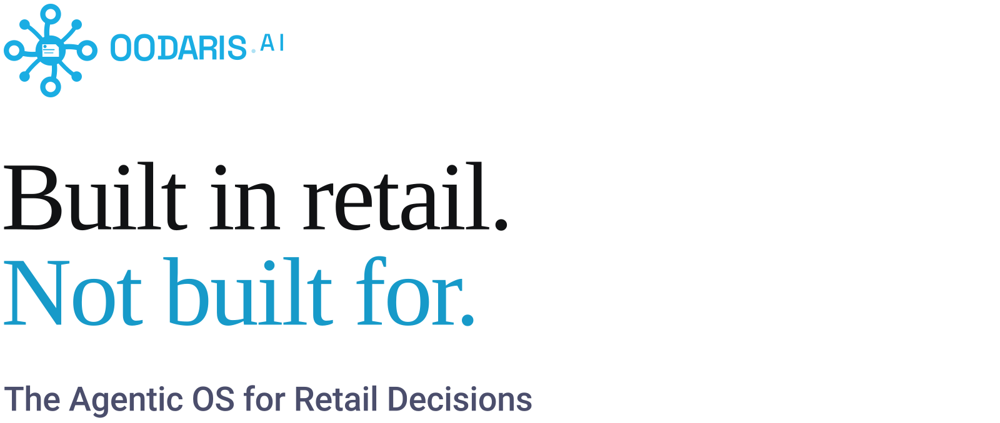

<picture>
  <source media="(prefers-color-scheme: dark)" srcset="./assets/banner-dark.svg">
  
</picture>

OODARIS is the Agentic OS for Retail Decisions, for fashion and footwear retailers. Every night it checks plan, stock, sell-through and price, explains what moved, and proposes a fix with its expected margin. By default, nothing is written back to your systems until the person who owns the decision approves it.

## One decision, end to end

<picture>
  <source media="(prefers-color-scheme: dark)" srcset="./assets/decision-dark.svg">
  
</picture>

[Watch this decision get made](https://oodaris.ai/en#home-agentic-monday) on oodaris.ai.

## Ten capabilities

All ten are available and run on one data model, so each one you add reuses the same data and integrations.

| Stage | Capability | What OODARIS proposes |
| --- | --- | --- |
| Plan | Demand forecasting | Demand curves by style, store and week, with what moved them |
| Plan | MFP & OTB | Season targets for sales, margin, receipts and inventory, and the budget left to buy by department, channel and month |
| Plan | Assortment planning & optimization | Which styles go to which store clusters, and how deep |
| Buy | Purchase orders & procurement | Order splits, alternate suppliers or new terms when a supplier slips |
| Buy | Sizing & prepacking | Size curves and pack builds for each store cluster |
| Flow | Allocation planning & optimization | Units by store and size run |
| Flow | Replenishment | The daily replenishment order, within pack, minimum-order and vendor rules |
| Flow | Transfers | Store-to-store transfers before a size run breaks |
| Sell | Pricing, markdown & promotions | Price ladders inside MAP, MSRP and margin floors, markdown depth and timing, and offer depth and audience for each campaign |
| Sell | Order fulfillment | Routing each online order to the warehouse or store best placed to ship it |

[Twelve specialist agents](https://oodaris.ai/en/agents) work in these stages, and each proposes a change with its evidence. The AI Orchestrator connects them. It proposes the order of work, and a resolution when two agents disagree. It approves nothing.

## How a decision runs in production

Every decision moves through five stages, with a contract between each.

| Stage | Contract | Runs on |
| --- | --- | --- |
| 1. Assemble context | Product, location, calendar, inventory, plan and policy context | Canonical data contracts |
| 2. Scope and route work | A bounded task for an agent, model, optimizer or enterprise service | Coordinator and shared context |
| 3. Generate a recommendation | A proposed action, with its rationale and stated confidence | Models, optimization, and rules |
| 4. Review and approve | A policy check against limits and confidence thresholds, then approval | Policy gate and human approval |
| 5. Write back and learn | Writeback, then the outcome against the expected result | APIs, events, and audit trail |

One trace ID links the source inputs, the agent and model runs, the approval, the writeback and the outcome, and each writeback has a rollback path.

How much OODARIS does is your call, in four levels:

- **OODIE**, the agent your team talks to: ask it anything about OODARIS, run scenarios and simulations, or change a value, always with approval.
- **Advisory**: read-only signals.
- **Prescriptive**, the default: human approval required.
- **Autonomous**: OODARIS acts inside guardrails the decision's owner sets, and every action is logged with its reason and can be reversed.

## Where it fits in your stack

Nothing is migrated, and your systems of record stay authoritative.

- **Reads from:** SAP ECC or S/4HANA, Microsoft D365, Oracle Retail, NetSuite, APTOS, POS, Shopify, data warehouses and custom sources.
- **Writes back:** plan updates, price conditions and markdowns, and transfer orders and pack changes, through the target system's own APIs or event paths.
- **A pilot needs:** POS or ERP access, sales transaction history and inventory data, ideally at SKU level.
- **First live cycle:** 8–12 weeks from kickoff.

Access is identity- and role-based, data is encrypted, and each customer's data stays inside its own tenant boundary. OODARIS makes no certification claims. Architects and security teams can [request an architecture review](https://oodaris.ai/en/contact?topic=technical-architecture-review).

## Measured results

- +4–8% gross-margin dollars, from the same inventory
- −8–12pp discount depth, with units still cleared
- +1–3pp margin rate, from more deliberate discounting

Ranges measured in pilots and in production, against an agreed control. The ranges are not guarantees.

## Research

OODARIS builds on the OODA loop. Observe, Orient, Decide and Act think fast and act. Reflect, Iterate and Serve think slow: they compare what was predicted with what happened, adjust, and serve the new version back, which feeds the next Observe. Together, their initials spell the name.

The founder, Fatih Nayebi, wrote the [books behind OODARIS](https://oodaris.ai/en/research):

- *Foundations of Agentic AI for Retail*, third edition, October 2026
- *Foundations of Agentic AI Systems*, one book in two volumes, October 2026: *Models, Learning, and Decisions, from First Principles* and *Agents, Operations, and Governance, in Production*

Each has a free sample at [fatihnayebi.com](https://fatihnayebi.com/books/). There's also a guide to [agentic AI for retail planning](https://oodaris.ai/en/agentic-ai-for-retail) and a [planning glossary](https://oodaris.ai/en/glossary).

## For developers

Three read-only JSON endpoints need no authentication and accept only `GET`.

```console
$ curl -s https://oodaris.ai/api/services | jq '.[0]'
{
  "id": 1,
  "stage": "plan",
  "name": "Demand forecasting",
  "description": "Demand curves by style, store and week, with what moved them. Available to new clients."
}
```

- [`openapi.yaml`](https://oodaris.ai/openapi.yaml) describes the endpoints, [`agents-directory.json`](https://oodaris.ai/agents-directory.json) every agent, and [`llms.txt`](https://oodaris.ai/llms.txt) the site.
- [autocodex](https://github.com/oodaris/autocodex), an MIT-licensed Go CLI, runs the Codex CLI through a structured loop: ideate, plan, implement, review and test.

## Open roles

Full-time roles in Montréal or remote anywhere in Canada, with core hours on Eastern Time.

- [AI Engineer](https://oodaris.ai/en/careers/ai-engineer): build the agents that run every night in production, and the evaluations and tracing that show whether their proposals are right.
- [Full Stack Engineer](https://oodaris.ai/en/careers/full-stack-engineer): build the screens where planners review, question and approve what our agents propose, and the typed APIs behind them.
- [AI Product Manager](https://oodaris.ai/en/careers/ai-product-manager): own one of our planning decisions end to end.
- [Founding Account Executive](https://oodaris.ai/en/careers/founding-account-executive): be our first salesperson.

The stack is asynchronous Python and FastAPI, Postgres with vector search, Redis, Docker, OpenTelemetry, React 19 and TypeScript. Apply on each role's page, or write to [careers@oodaris.ai](mailto:careers@oodaris.ai).

## Contact

Write to [contact@oodaris.ai](mailto:contact@oodaris.ai): a person on the team replies within 24 hours. Press: [press@oodaris.ai](mailto:press@oodaris.ai). OODARIS AI is based in Montréal, Canada, and is on [LinkedIn](https://www.linkedin.com/company/oodaris-ai/). [oodaris.ai](https://oodaris.ai) is in English, French, Spanish, Turkish, German, Italian and Portuguese.

<!-- Checked against https://oodaris.ai/llms-full.txt, last updated 2026-10-29. When the site changes, update this profile and this date: see README.md at the repository root. -->
